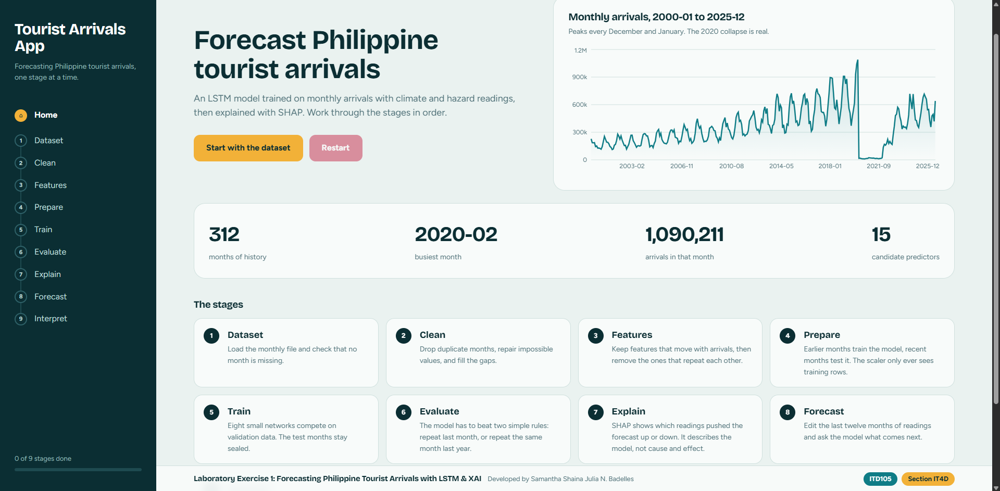
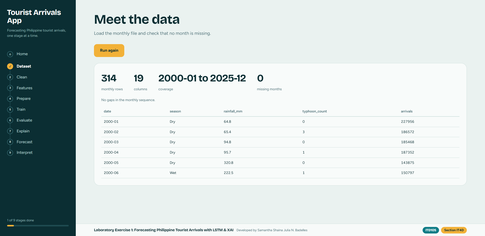
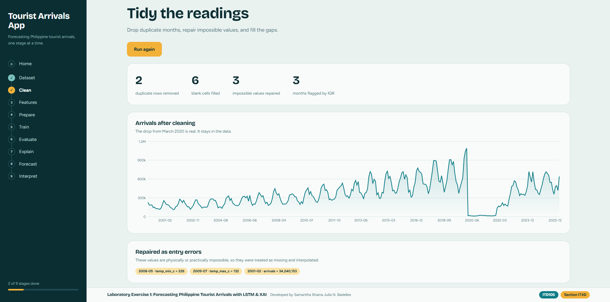
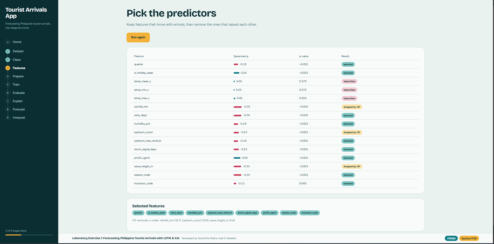
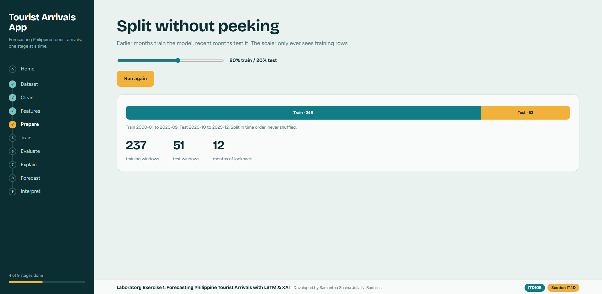
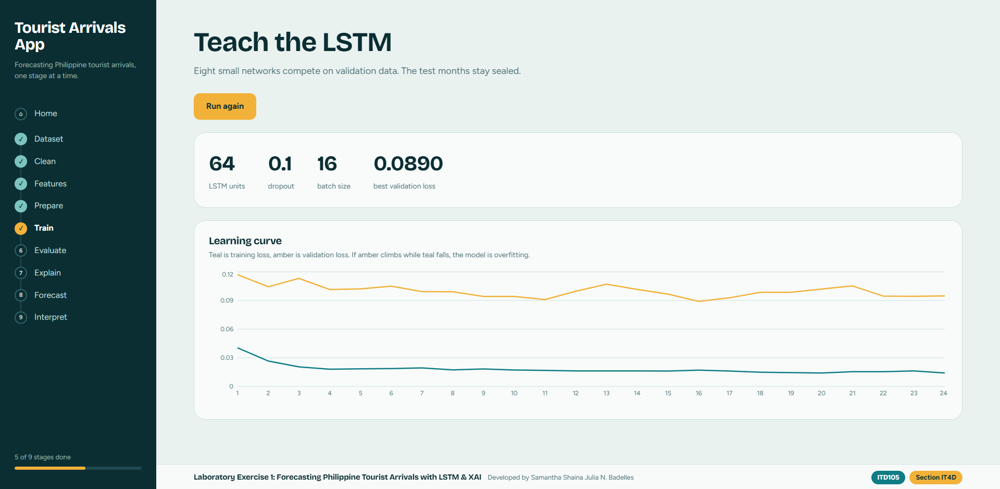
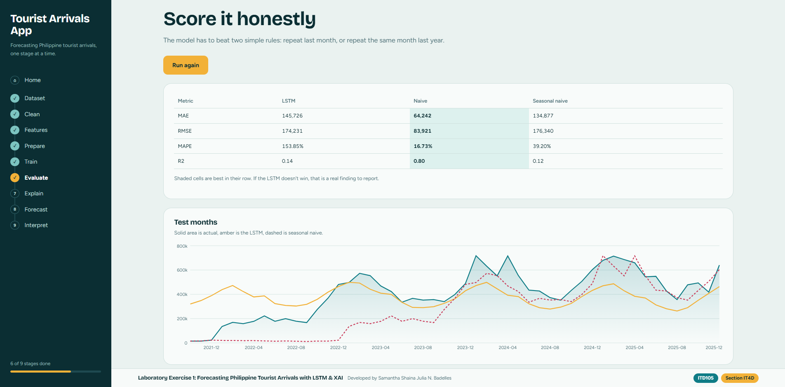
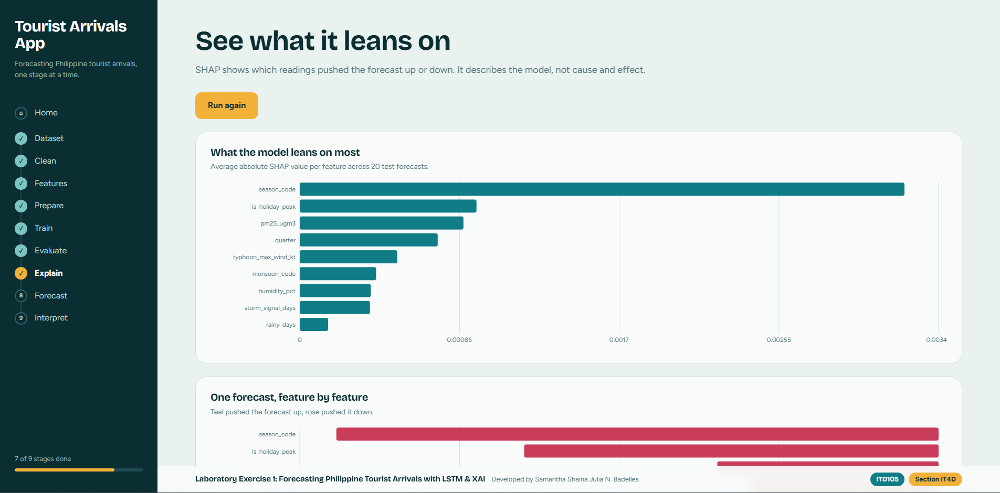
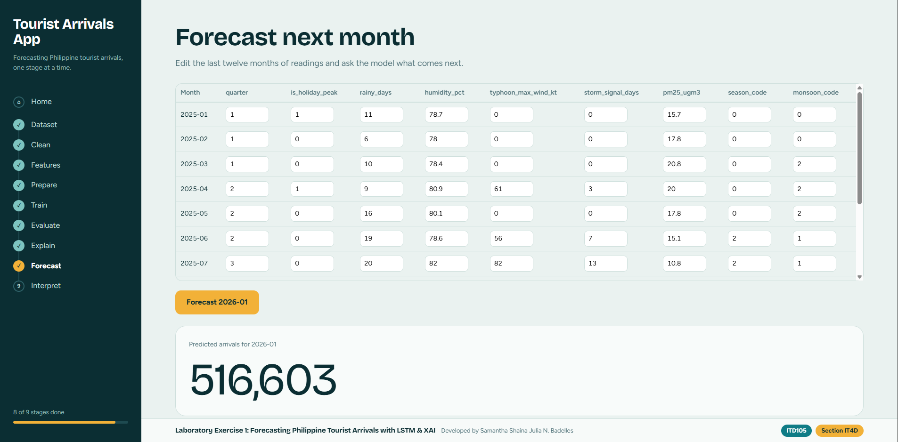
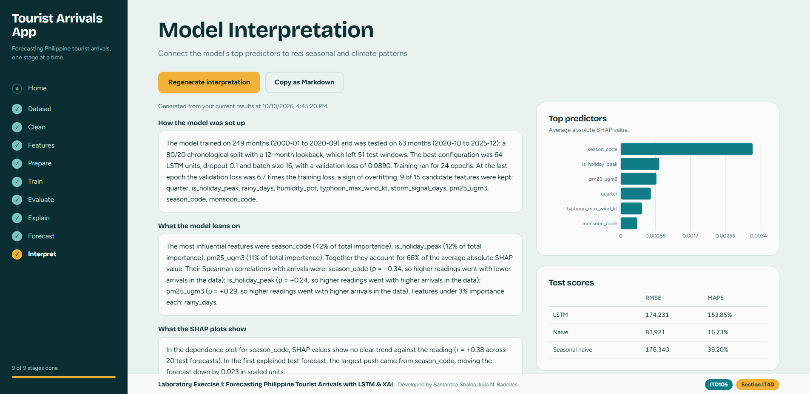

# Philippine Tourist Arrivals Forecasting (LSTM + SHAP)

**Laboratory Exercise 1** | [ITD105] | [IT4D] | [Samantha Shaina Julia N. Badelles]

A full-stack app that forecasts monthly Philippine tourist arrivals from climate and hazard
readings. It follows the Module 2 pipeline: cleaning, Spearman-then-VIF feature selection,
leakage-safe preprocessing, an LSTM, and SHAP explanations. Every stage is its own page.

- **Backend:** FastAPI (Python 3.12), TensorFlow/Keras, SHAP, statsmodels
- **Frontend:** Next.js 14, Recharts
- **Streamlit baseline:** [`streamlit-app/`](streamlit-app) holds the graded Streamlit version of the same pipeline.

Demo video: https://drive.google.com/file/d/1fpMd8cUMzkXKqrJ3Yjm3CQuV3P2TKOny/view?usp=sharing

## Screenshots




       
       





## Pipeline

| Stage | What it does |
|---|---|
| Dataset | Loads the CSV and checks for missing months |
| Clean | Removes duplicate months, repairs impossible values, fills gaps |
| Features | Spearman filter (\|ρ\| > 0.10, α = 0.05), then iterative VIF (< 5) |
| Prepare | Chronological split, scaler fit on training rows only, 12-month windows |
| Train | Grid search over units, dropout and batch size, scored on validation data |
| Evaluate | MAE, RMSE, MAPE and R² against naive and seasonal-naive baselines |
| Explain | SHAP global importance, a single-forecast breakdown, a dependence plot |
| Forecast | Edit the last 12 months of readings and predict the next month |
| Interpret | Generates a written interpretation from the current results on demand |

## Data cleaning decisions
- **Duplicates:** 2006-06 appeared 3 times with different arrivals. The first row was kept.
- **Missing values:** 3 blank `arrivals` values and 3 blank temperature readings were filled by linear interpolation.
- **Impossible values:** `temp_min_c` = 226.05, `temp_max_c` = 132.26 and `arrivals` = 34,240,153 were treated as entry errors, set to missing and interpolated.
- **COVID-19 drop (2020-03 to 2021-12):** flagged by the IQR rule but kept, because it is real.
- **Encoding:** `season` and `monsoon` were converted to numeric codes.

## Results
Split: [80/20] chronological. Lookback: 12 months.

**Selected features:** 
quarter
is_holiday_peak
rainy_days
humidity_pct
typhoon_max_wind_kt
storm_signal_days
pm25_ugm3
season_code
monsoon_code

**Best hyperparameters:** units = 64 LSTM, dropout = 0.3, batch size = 32

| | MAE | RMSE | MAPE | R² |
|---|---|---|---|---|
| LSTM | 159,134 | 210,284 | 219.47% | 	-0.25 |
| Naive | 	64,242 | 	83,921 | 16.73% | 0.80 |
| Seasonal naive | 134,877 | 176,340 | 39.20% | 0.12 |

## Interpretation
### How the model was set up

The model trained on 249 months (2000-01 to 2020-09) and was tested on 63 months (2020-10 to 2025-12): a 80/20 chronological split with a 12-month lookback, which left 51 test windows. The best configuration was 32 LSTM units, dropout 0.1 and batch size 32, with a validation loss of 0.0814. Training ran for 10 epochs. At the last epoch the validation loss was 5.5 times the training loss, a sign of overfitting. 9 of 15 candidate features were kept: quarter, is_holiday_peak, rainy_days, humidity_pct, typhoon_max_wind_kt, storm_signal_days, pm25_ugm3, season_code, monsoon_code.

### What the model leans on

The most influential features were is_holiday_peak (54% of total importance), quarter (11% of total importance), humidity_pct (9% of total importance). Together they account for 74% of the average absolute SHAP value. Their Spearman correlations with arrivals were: is_holiday_peak (ρ = +0.24, so higher readings went with higher arrivals in the data); quarter (ρ = −0.19, so higher readings went with lower arrivals in the data); humidity_pct (ρ = −0.19, so higher readings went with lower arrivals in the data). Features under 3% importance each: monsoon_code, pm25_ugm3.

### What the SHAP plots show

In the dependence plot for is_holiday_peak, SHAP values rise as the reading rises (r = +0.98 across 20 test forecasts). In the first explained test forecast, the largest push came from rainy_days, moving the forecast down by 0.017 in scaled units.

### How it did against the baselines

On the test months the LSTM scored MAE 151,046, RMSE 204,755, MAPE 205.07% and R² -0.18. The stronger baseline was Naive (RMSE 83,921). The LSTM did not beat it on RMSE, which was 144% higher. A negative R² means the model predicted worse than simply using the average of the test months. The largest miss was 2022-02: predicted 623,202 against an actual 168,768.

### What these results do not tell us

Only 51 test windows were scored, so each metric moves noticeably with a few months. 0 months flagged as outliers fall inside the test range and 3 inside the training range, so unusual months shape both the fit and the score. VIF removed rainfall_mm, typhoon_count, wave_height_m; the features that stayed may carry part of their effect, so importance is shared among correlated readings. SHAP was computed on the first 20 test windows. It describes what this model learned, not what causes arrivals to change.


SHAP values describe what the model learned, not causal effects.

## How to run (Windows)

**Backend** (Python 3.12):
```powershell
cd backend
py -3.12 -m venv .venv
.\.venv\Scripts\Activate.ps1
pip install -r requirements.txt
# put tourist_arrivals.csv in backend\data\
uvicorn main:app --reload --port 8000
```

**Frontend** (Node.js 20 LTS), in a second terminal:
```powershell
cd frontend
npm install
npm run dev
```
Open http://localhost:3000 and run the stages in order. API docs are at http://localhost:8000/docs.

## Notes
- Pipeline state is kept in the backend's memory. Restarting the backend (including the auto-reload when `main.py` is saved) clears the trained model, so run the stages again. The Restart button on Home also clears it.
- SHAP uses `KernelExplainer` because DeepExplainer and GradientExplainer do not support this LSTM's TensorFlow ops.
- The dataset file is [included in `backend/data/` / not included; place your own copy there].

## Author
Samantha Shaina Julia N. Badelles, ITD105 IT4D
